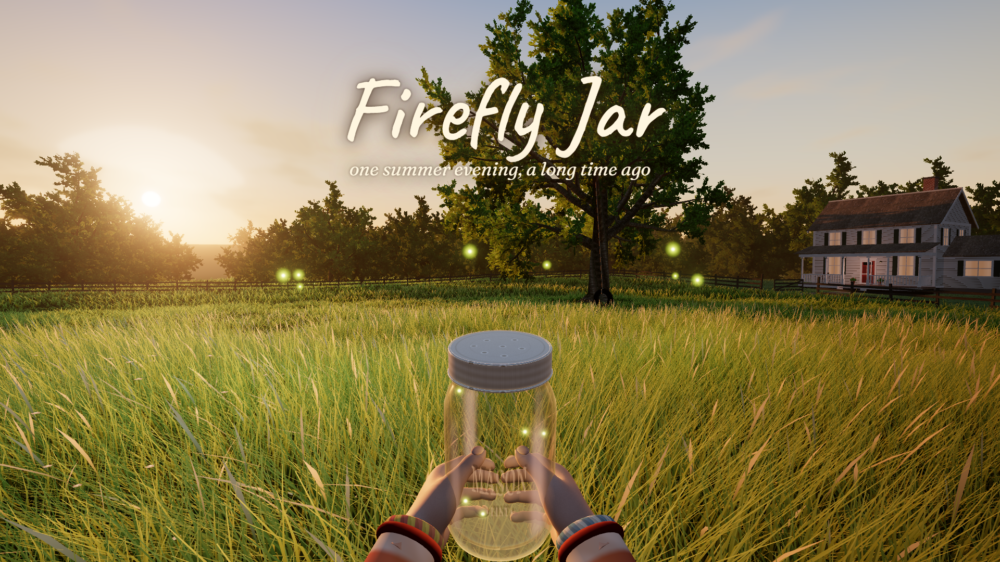

# Firefly Jar

One summer evening when you were eight. You are standing in a meadow at the edge of a small town
with a glass jar in your hands. The sun is going down, the fireflies are coming out, and you have
until dark to catch twenty of them. Then you let them go.

**Play: https://starknightt.github.io/firefly-jar/**



A short trailer with sound is in [`trailer.mp4`](trailer.mp4).

## How to play

- **Computer:** click to start. `W` `A` `S` `D` to wander, mouse to look, `Shift` to run. Walk up
  to a firefly, put the dot on it and click. `Esc` frees the mouse; `M` mutes.
- **Phone:** tap to start. Left thumb anywhere on the left side to wander (push to the rim to run),
  drag on the right to look, tap a firefly to catch it. Works in portrait and landscape.

Each firefly makes the jar glow brighter, and brings night a little closer. After dark they are
shy: run at one and it bolts, walk up, stop when the ring lights and it lets you. The gate is open, so you can wander up the
path to the porch. When the jar holds twenty, you lift it and open the lid.

It takes about five minutes. Sound on is better.

Measured on an RTX 4060 at 1920x1080: about 100 fps on average, with the slowest 1% of frames
still at 60 fps or better (details in `notes.md`).

## What is in it

- three.js on the WebGPU renderer with TSL shaders, and a WebGL2 fallback for phones without
  WebGPU. Three quality tiers, picked automatically.
- A whole evening driven by one number from golden hour to night: sun, sky, haze, light,
  exposure, crickets and the lights in the farmhouse all follow it.
- About 260,000 tufts of grass placed in the vertex shader in rings around you, with wind gusts,
  backlight through the blades, seed heads, and blades that part around your legs. Four kinds of
  wildflower.
- An oak with a tire swing, a weathered fence, a clapboard farmhouse with a porch light, a
  treeline, a power line and a town on the horizon.
- Your hands and the jar: the light from inside spills on your fingers and the grass, and one
  hand lifts the lid for every catch. Look down and the rest of you is there too.
- Twenty fireflies you can catch, and several hundred more you cannot, out over the fields and
  against the far trees.
- Real cricket and breeze recordings, a music box melody that adds layers as the jar fills, and a
  bell for every catch.

## Run it locally

```powershell
pnpm install
pnpm dev
```

then open the address it prints. `pnpm build` writes the static site to `dist/`.

URL options: `?q=low`, `?q=medium` or `?q=high` pins the quality tier, `?webgl` forces the WebGL2
fallback, `?debug` logs which GPU the page got.

## Files

- `src/` the game. `public/assets/` models, textures and sound.
- `trailer.mp4` 1920x1080, 60 fps, with sound. `thumbnail.png` one frame of it.
- `notes.md` how it was built, what each review round found, and the frame rate measurements.
- `CREDITS.md` every third-party asset and its licence.
- `tools/` the test, capture and trailer scripts (headless Chrome on the GPU through Playwright).

Note on the trailer: it is real gameplay, recorded frame by frame from the game running in fixed
1/60 s steps with an autopilot doing the walking, aiming and clicking. The soundtrack was rendered
by the game's own sound code from the same sequence of events.

## The prompt

This game was built by Claude Code (Fable 5.2) from the prompt below.

> build a cozy browser game. you have full freedom: use any framework, library, engine feature or
> technique you want, and any third-party assets (models, textures, sounds, music) as long as the
> license allows public use. credit them in CREDITS.md. if something looks fake or cheap, replace
> it with something better.
>
> THE FEELING
> a perfect american summer evening when you're a kid. warm, nostalgic, calm. golden hour slowly
> turning into a soft blue night. the kind of thing a non-tech person sends to a friend because it
> reminds them of being 8 years old.
>
> THE GAME
> - first person, as a kid: you see your own small hands holding a glass jar in front of you.
>   you're in a big meadow at the edge of a small town: tall grass, wildflowers, an old wooden
>   fence, a big oak tree with a tire swing, a farmhouse with a warm lit porch, distant trees.
> - fireflies start blinking as the sun goes down. click or tap a firefly to catch it into the jar.
> - each firefly you catch makes the jar glow brighter. the jar's warm light spills onto your hands
>   and the grass as it gets dark.
> - fireflies drift in soft, natural patterns, a little harder to catch as night falls.
> - when the jar is full (20 fireflies), you lift the jar and open it, and they all float up into
>   the sky and turn into stars. that's the ending.
> - controls: WASD + mouse look on desktop, a virtual joystick + drag to look on phone. must work
>   perfectly on both.
> - sound: crickets, a soft summer breeze, a gentle music box melody that grows as the jar fills,
>   a little chime on each catch.
>
> TRAILER
> record trailer.mp4, 1920x1080 60fps with sound, 30-45 seconds. open on the most beautiful frame
> (golden meadow with the first fireflies and the jar in your hands) in the first second. show
> real gameplay: catching fireflies, the jar glowing brighter, night falling, and the ending when
> they rise into the stars. add simple text cards between shots like "catch fireflies before night
> falls", "playable on your phone". no black fades. also make thumbnail.png.
>
> QUALITY (sequential, one agent at a time)
> 1. builder builds or improves the game.
> 2. a fresh critic subagent (same model) that never saw the code plays it and looks at screenshots
>    on desktop and phone sizes. it lists everything that looks cheap, confusing or not fun. never
>    allowed to say "looks good".
> 3. builder fixes the biggest problems first. max 5 rounds, then ship. log every round in
>    notes.md.
>
> SHIP
> my pc: rtx 4060, 60 fps at 1080p, measure it.
> create a public github repo StarKnightt/firefly-jar, push, enable github pages, open the live
> link and confirm it works on desktop and phone size. readme with a short description, the play
> link, the full prompt, and my support buttons like my sky-islands repo.

And one addition, sent while it was being built:

> one addition: before going further, find real reference photos (public domain or licensed for
> reuse, saved in refs/) of: fireflies in a meadow at dusk (long exposure and normal), a glass
> mason jar glowing with fireflies at night, golden hour tall grass with backlight, an old
> farmhouse porch light at dusk. the critic must compare its screenshots side by side with these
> references every round, not just judge them alone.

## Support

<p>
  <a href="https://buymeacoffee.com/prasenx"></a>&nbsp;&nbsp;
  <a href="https://github.com/sponsors/StarKnightt"></a>
</p>
